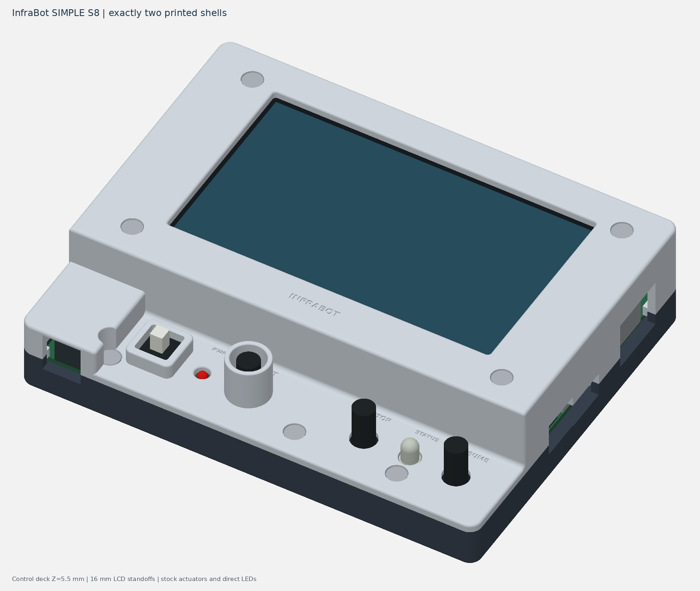
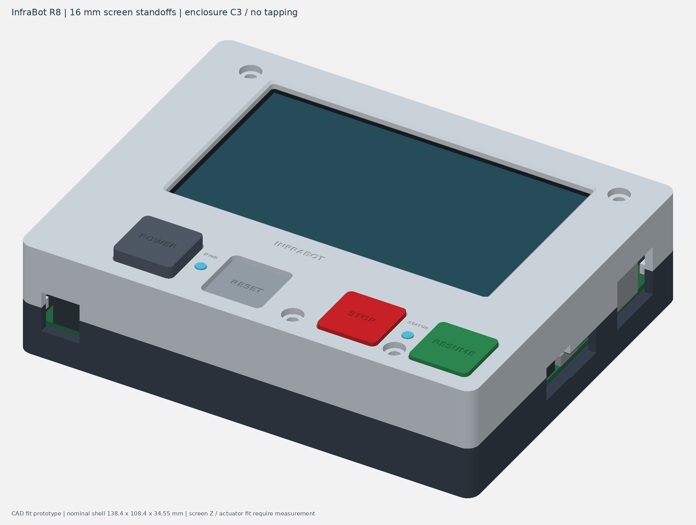

English | [简体中文](README.zh-CN.md)

# InfraBot 4.3-inch enclosure

Printable enclosures for the InfraBot R8 4.3-inch controller board, the EmbedFire STM32H743 Challenger V2 core board and the 4.3-inch display. Download the STL files for your edition and import them in millimetres.

| | Simple S8 | Deluxe C3 |
|---|---|---|
| Assembled |  |  |
| Print set | Two shell halves | Nine assembly parts and two optional fit tests |
| Controls | PCB switches and LEDs accessible directly | Four keycaps and two transparent light pipes |
| Display spacers | Four 16 mm M3 female–female | Four 16 mm M3 male–female |
| Downloads | [STL](simple/STL) · [STEP](simple/STEP) · [assembly and hardware](simple/README.md) | [STL](deluxe/STL) · [STEP](deluxe/STEP) · [assembly and hardware](deluxe/README.md) |

**Fit prototypes.** Files starting with `00_` are assembly references. Print only the individual STL parts. Check glass height, spacer thread depth, core-board clearance, switch and LED heights, ribbon bend and mating plugs against your hardware before tightening the lid. The display stack assumes a glass surface 22.65 mm above the base PCB top and 0.5 mm nominal cover clearance. [R8 PCB design](https://github.com/YaolinDong/infrabot-pcb-4p3)

Each edition contains its print list in `parts.json`, nominal dimensions in `parameters.json`, and assembly views under `preview/`. Run `python3 -B tools/verify.py` to check the downloaded snapshot. [Model index](model-index.json) · [Build instructions](docs/build.md) · [Verification and fit limits](verification/README.md)

## Licenses

| Content | Files | License |
|---|---|---|
| Models and design data | STL, STEP, DXF, design and index JSON, frozen inputs | [CERN-OHL-P-2.0](LICENSE) |
| Scripts, tests and CI | Edition source code, tools, tests and workflows | [MIT](LICENSES/MIT.txt) |
| Documentation and images | Markdown and preview PNGs | [CC-BY-4.0](LICENSES/CC-BY-4.0.txt) |

Copyright © 2026 YaolinDong (董耀琳)
