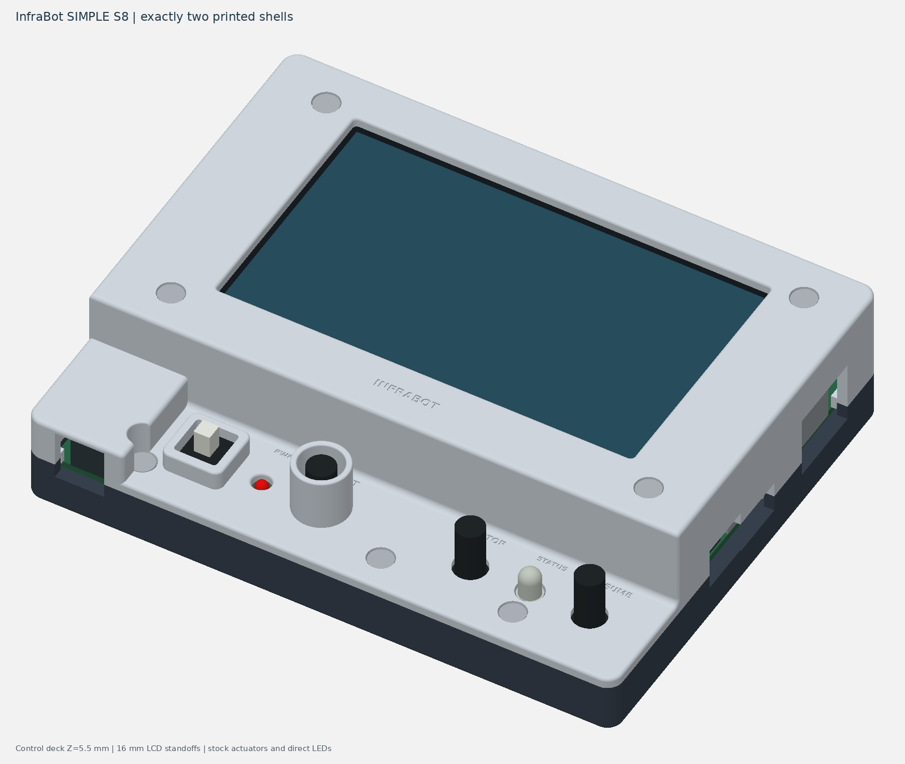
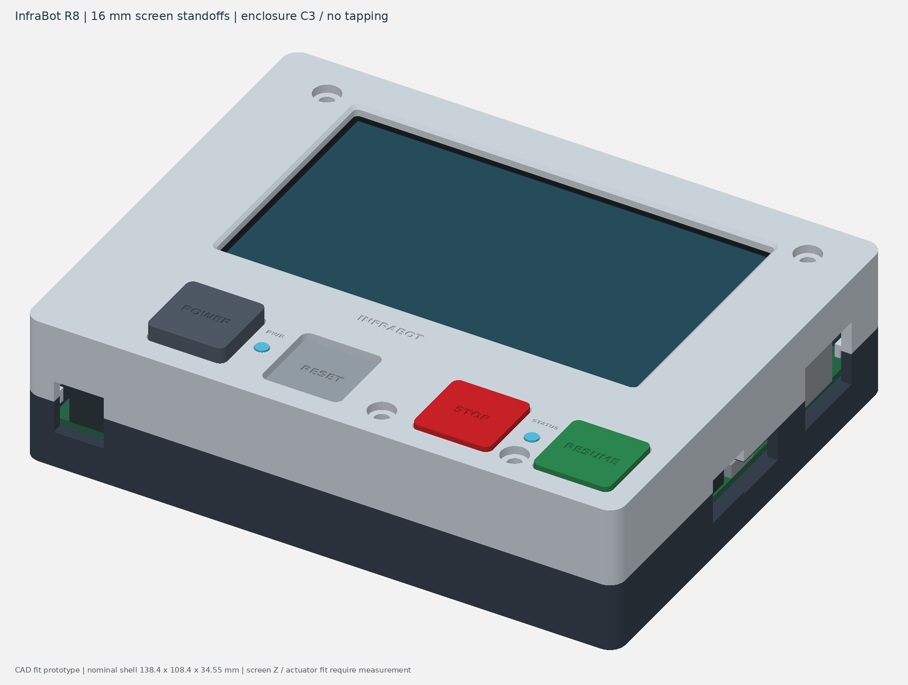

[English](README.md) | 简体中文

# InfraBot 4.3 寸控制板外壳

这两款外壳适配 InfraBot R8 4.3 寸控制底板、野火 STM32H743 挑战者 V2 核心板和 4.3 寸屏。下载所选版本的 STL，按毫米导入切片软件即可，不要缩放。

| | 简单版 S8 | 精装版 C3 |
|---|---|---|
| 装配效果 |  |  |
| 打印件 | 上下壳共 2 件 | 9 件正式件，另有 2 件选用试装件 |
| 按键和指示灯 | 直接操作板载开关、观察板载 LED | 4 个键帽、2 根透明导光柱 |
| 屏幕铜柱 | 4 根 M3 双通，长 16 mm | 4 根 M3 单头，本体长 16 mm |
| 外形尺寸 | 138.4 × 108.4 × 34.55 mm | 138.4 × 108.4 × 34.55 mm，POWER 键帽另高出 3.5 mm |
| 下载和装配 | [STL](simple/STL) · [STEP](simple/STEP) · [五金及装配](simple/README.zh-CN.md) | [STL](deluxe/STL) · [STEP](deluxe/STEP) · [五金及装配](deluxe/README.zh-CN.md) |

**目前为试装模型。** `00_` 开头的文件供查看装配关系，打印时选择各零件 STL。玻璃表面暂按高出底板 PCB 顶面 22.65 mm 设计，上壳名义余量 0.5 mm。合壳前请实测玻璃叠高、铜柱两端有效牙深、核心板净空、开关及 LED 焊接高度、排线弯曲空间和配对插头外形。[R8 控制底板](https://github.com/YaolinDong/infrabot-pcb-4p3)

各版本的 `parts.json` 列出打印件和五金，`parameters.json` 保存设计尺寸，`preview/` 提供装配图。运行 `python3 -B tools/verify.py` 可离线校验下载内容。[模型索引](model-index.json) · [重新生成](docs/build.md) · [校验范围](verification/README.md)

## 许可证

| 内容 | 文件 | 许可证 |
|---|---|---|
| 模型与设计数据 | STL、STEP、DXF、设计及索引 JSON、冻结输入 | [CERN-OHL-P-2.0](LICENSE) |
| 脚本、测试与 CI | 各版源码、工具、测试、工作流 | [MIT](LICENSES/MIT.txt) |
| 文档及图片 | Markdown 和预览 PNG | [CC-BY-4.0](LICENSES/CC-BY-4.0.txt) |

Copyright © 2026 YaolinDong (董耀琳)
